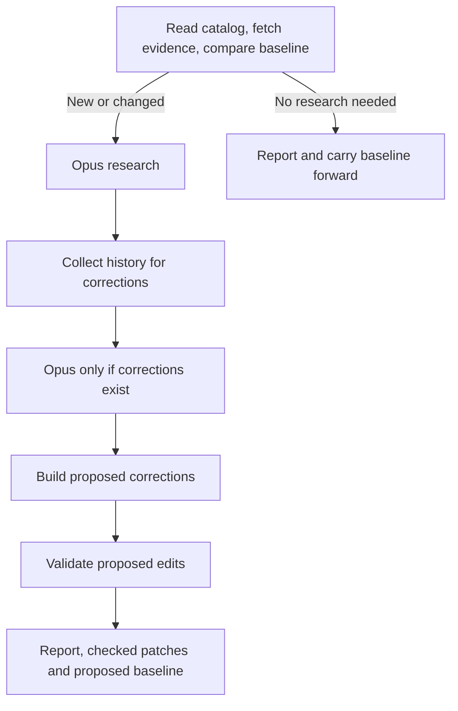

# Catalog freshness review

This opt-in workflow compares current source evidence with saved, completed reviews.
Only new entries, changed catalog claims, or changed watched evidence go to Opus.
Unchanged entries make no model calls. Scheduling and spending policy belong to the
caller: the workflow has no budget gate, scheduler, or rotating sample.

## First review and subsequent runs

1. Build a source inventory without a model, if desired:
   `python3 .um/freshness/scripts/catalog.py`. This writes
   `.um/freshness/work/inventory.json`. Observations are **not** completed reviews.
2. Run the workflow with locally authenticated Claude Code, or an API key in
   GitHub Actions. It scans the entire catalog and researches selected entries
   in sequential batches of at most 20.
3. Review the report and proposed `baseline.json`, then commit it as
   `.um/freshness/baseline.json`.
4. Future runs compare live sources to that baseline and research only changes.
   Review and commit each proposed replacement baseline to retain new coverage.

Every run compares the whole catalog. There is no entry-count or slice selector.
Only new entries, changed claims, or changed watched sources enter research batches.
A baseline is optional; its absence means entries need an initial review.
Baseline identities use URL and section,
so insertion of another entry and line-number shifts do not trigger reanalysis.

```sh
um workflow run --source-root .um/freshness --execution-root . \
  --run-dir /tmp/ratatui-review-unique --json \
  .um/freshness/workflow.yaml
```

Use a unique run directory outside the checkout. Review results before copying the
baseline artifact; do not overwrite concurrent baseline updates from another run.
Only supported keeps with complete, stable snapshots enter the baseline; reviewed
entries with unresolved findings or snapshot failures remain pending.

## What change detection watches

GitHub sources use authenticated, read-only repository metadata and recursive file
trees. Fingerprints include canonical repository identity, description, archive
status, default branch, README files, Markdown under `docs/`, and package manifests
throughout the tree, including workspace members. Source contents are represented
by Git blob hashes; no model is needed to collect or compare them. Unrelated source
commits do not trigger analysis. Crates.io entries also watch crate identity,
description, repository and latest version, plus the linked GitHub repository.
Other sites use the linked page's final URL and body hash.

This is a defined evidence watch, not proof that every behavior change will be
detected. Changes confined to unwatched source files can be missed. Whole-page
fingerprints can trigger extra reviews for cosmetic changes. GitHub tree requests
still consume API quota, and large repositories can return truncated trees.

Fetch failures, unsupported crate repositories, truncation, uncertainty, blockers,
and proposed corrections stay pending. An outage is never treated as a removal or
an unchanged review. Only evidence-backed `keep` results advance the baseline;
watched sources are fetched again to ensure they did not change during research.
Catalog claims and contribution rules are also fingerprinted. Corrections must be
accepted and the corrected entry reviewed before it becomes a completed baseline.
No model-free inventory can be silently promoted to a reviewed baseline.

## Workflow graph



The eight declared UM nodes remain visible individually. When nothing needs research,
six stages are skipped and only preparation and reporting run. With research but no
corrections, the history stage returns an empty review without starting Claude and
validation performs no checker work. Research receives selected entries, source
fingerprints, previous reviews, and contribution rules rather than the full catalog.

The research stage runs the native UM agent workflow in `research-batch.yaml` once
per batch, using Opus 5.5 at medium effort. UM 0.72.1 has no dynamic loop node; the
command stage batches the selected entries and verifies exact coverage before
combining their results. A failed or incomplete batch fails the run rather than
publishing a partial review. Batch usage receipts are included in the artifacts.
History review uses
Claude Code with the same model and effort inside its command stage, with tools
disabled: it interprets the collected discussion records. This permits an empty
packet to return a typed result without a model call. UM 0.72.1 requires all referenced
condition outputs to be available, even across skipped branches; the command stage
avoids an unavailable-output join. All inter-stage inputs use declared UM references.

There are two mutually exclusive export sets: `report`, `proposals`, `baseline` for
research runs; `unchangedReport`, `unchangedProposals`, `unchangedBaseline` otherwise.
Both write the same final report and ZIP locations. GitHub Actions invokes UM once,
displays the successful report and uploads the ZIP. It does not orchestrate research.

## Outputs and safety of proposals

The Actions summary leads with outcome counts and checked diffs. Held changes show
their reason, with their diff collapsed. Evidence, baseline instructions and full
research are expandable; raw check records remain in the downloaded artifacts.
Each researched entry includes evidence, blockers, caveats and a recommendation.
The report also shows scanned, unchanged, researched and pending counts. The ZIP
contains the report, proposed baseline, available correction patches, discussion
records and validation logs. No correction PRs, comments, merges or catalog edits
are submitted. Maintainers decide which changes to accept.

Canonical names, URLs and description claims are checked separately from continued
relevance. Verified renames move only the entry within its existing contiguous list.
Informational caveats stay visible; proposal-specific blockers hold corrections.

History collection searches upstream and the fork, retrieves bodies, comments,
reviews and changed-file patches, and holds incomplete results. Limits are 30 search
matches per query, 10 discussions per candidate, 100 records per detail endpoint,
and bounded evidence sizes. GitHub search does not index patch contents, so a PR
mentioning an entry only in its diff can be missed. A closed-unmerged PR alone does
not prove rejection. History interpretation remains model judgment.

Correction validation uses awesome-lint 2.3.0, typos 1.51.1 and Lychee 0.24.2 in a
disposable copy. Lint/spelling failures hold edits. Link checks compare baseline and
edited README files; unrelated pre-existing failures are distinguished from new or
changed-entry failures. Changed destinations require positive success evidence.
Checks are bounded to 180 seconds each. Missing tools, timeouts and failures hold
edits; there is no speculative repair loop. Catalog freshness is rechecked before
proposals are released. Validation does not prove factual correctness.

## GitHub setup

1. Merge the workflow into the repository's default branch to enable manual runs.
2. Configure `awesome-ratatui-review` with required reviewers and an
   `ANTHROPIC_API_KEY` environment secret.
3. Set repository variable `UM_FRESHNESS_ENABLED=true`.
4. Run **UM freshness review** on a reviewed branch. No inputs are needed; it
   compares the entire catalog automatically.

GitHub permissions are read-only and checkout does not persist credentials.
`FRESHNESS_GITHUB_TOKEN` supplies authenticated source and history requests. Research
agents retain normal tools, with instructions prohibiting external writes and
execution of project code; those instructions are not an execution sandbox.
The job uses UM 0.72.1, Claude Code 2.1.284, and a 180-minute timeout. Provider usage is
billable when models run. Local trials can use existing Claude Code authentication.

## Verification

The PR check tests correction, keep-only and unchanged branches, plus the offline
regressions and real positive/negative validation-tool fixtures. Integration tests
use synthetic inputs and do not make model calls.

```sh
python3 -m unittest discover -s .um/freshness/tests -v
um workflow validate --source-root .um/freshness --json .um/freshness/workflow.yaml
```
