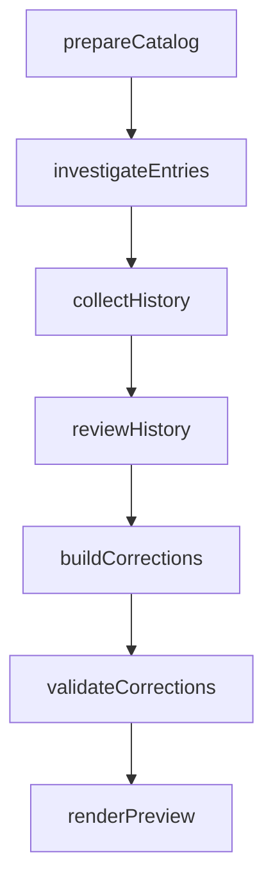

# Catalog freshness review

This opt-in workflow investigates a selected group of catalog entries and previews
checked corrections in the GitHub Actions summary. It researches current relevance,
checks prior discussions, and validates each proposed README edit in a disposable
copy. It never opens correction PRs, comments, merges, or edits the working checkout.

## What a run produces

Each entry has findings, evidence URLs, unresolved questions and a recommendation.
For each proposed correction, the summary adds:

- Prior-discussion status, search queries, reasons and cited issues/PRs.
- Original and edited catalog check results, with existing unrelated broken links
  listed separately from new failures or failures affecting the changed entry.
- Ready for maintainer review or Held, with the reason.
- Proposed PR title/body and a diff. Only ready proposals receive downloadable patches.

The `freshness-proposals` artifact contains the report, PR descriptions, available
patches, collected discussion records and validation logs. Each proposal changes one
entry, following the contribution guidelines. Maintainers still verify the evidence
and decide whether to open a correction PR.

## One UM workflow

The single `workflow.yaml` declares seven nodes, with typed output references
creating their dependency edges:



- **prepareCatalog** captures the checked-out catalog revision and selected entries.
- **investigateEntries** researches official sources and returns structured findings.
- **collectHistory** retrieves matching issue/PR bodies, comments, reviews and diffs.
- **reviewHistory** assesses duplicates, related context, rejections and merged fixes.
- **buildCorrections** constructs one-entry patches against the pinned catalog.
- **validateCorrections** applies edits in disposable copies, runs baseline/edited
  checks, applies history holds, and rechecks catalog freshness.
- **renderPreview** renders the decisions and exports the report plus proposals ZIP.

The five command stages read captured inputs from UM_STEP_INPUTS; they do not read
another stage's mutable output files. Validation logs are part of the declared
validated output. The rendering step consumes those results without rerunning checks.
UM owns stage ordering, failure propagation, retained outputs and final exports.
If a required stage fails, downstream work is blocked and no final preview is exported.
With no correction candidates, history review returns an empty review and later stages
produce a research-only report. There is no separate history workflow.

GitHub Actions installs the dependencies, invokes UM once, displays its exported
report and uploads the exported proposals ZIP. Its job contains no research,
history collection, patch-building or validation orchestration.

Search caps are explicit: 30 results per query, 10 discussions per candidate,
100 records per comments/reviews/files request (reaching that limit is treated as
incomplete), and bounded evidence sizes. Errors or truncation never count as a clean
search. Search is still limited by GitHub's index; it is not proof no prior discussion
exists. A closed-unmerged PR alone is not a rejection. A prior objection may be
considered addressed only when the history assessment explains concrete new evidence.
History classification remains model judgment; cited references are checked against
the collected records, but semantic correctness is not independently proven.

Validation uses awesome-lint 2.3.0 with a dependency lock, typos 1.51.1 and Lychee
0.24.2 with verified release checksums. Lint/spelling failures hold the edit. New
link failures, failures affecting the changed entry, and excluded destinations hold
it; unrelated failures present in both versions are reported separately. Missing
or timed-out checkers hold the edit. Checks are bounded to 180 seconds each. Failed
edits are withheld, without speculative automatic repair or a model retry loop.
Validation does not prove the factual merits of a removal or replacement.

## Enable a fork trial

1. Review and merge the integration into the fork's default branch when ready.
2. Configure `awesome-ratatui-review` with required reviewers and an
   `ANTHROPIC_API_KEY` environment secret.
3. Set repository variable `UM_FRESHNESS_ENABLED=true`.
4. Run **UM freshness review** on a reviewed branch with the desired slice number.

This remains a manual pilot, with no scheduler or persisted coverage. The original
586-entry snapshot has 196 flat slices (0 through 195); catalog edits can shift
those slices. Keep a manual record of reviewed entries during the trial.

One GitHub job uses published UM 0.72.1, official Claude Code 2.1.284 and Sonnet 5
at medium effort. The action is pinned to
`3b5d29379bc349df8d95b29b599e71701aa1d017`. Both agent stages are part of the same run; an empty history packet requires no
additional research. The job has a 45-minute timeout and no
dollar cap. Provider usage is billable once enabled.

GitHub permissions are read-only. Checkout does not persist credentials. The provider
key and read-only GitHub token are explicitly admitted to the UM run and available
to its steps. The token is passed under FRESHNESS_GITHUB_TOKEN; API commands map it
to the GitHub CLI environment only when used.
Agent tools remain available, with instructions prohibiting external writes and
execution of project code. Those instructions are not an execution sandbox.

## Check and preview the integration

The **Check UM freshness integration** PR check runs offline tests, exercises the
real validation tools on an intentionally invalid fixture, executes all seven UM
stages with synthetic agent/network/check results, and renders a clearly
labeled fictional preview. The preview's simulated checks are not live findings.
Download `freshness-example` to inspect its example patch and PR description.

```sh
python3 -m unittest discover -s .um/freshness/tests -v
um workflow validate --source-root .um/freshness --json .um/freshness/workflow.yaml
actionlint .github/workflows/um-freshness.yml .github/workflows/um-freshness-checks.yml
```

The earlier local prototype's Yardlet result, Burn false-alarm risk, 14 tests and
roughly $0.23 cost apply to a different implementation. They do not establish this
workflow's accuracy, cost or time savings. No live model audit has been performed
for this revision. A prospective fork trial remains necessary before scheduling.
